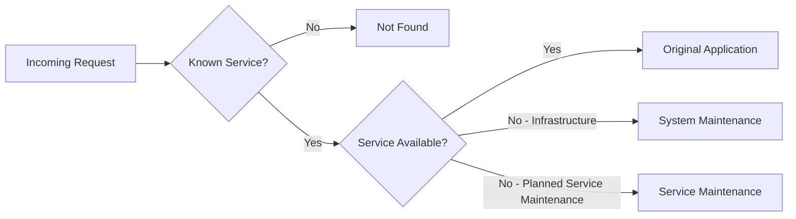

# Fallback Pages

**Link:** *[Cloudflare Page](https://fallback-pages-eew.pages.dev)*

Fallback Pages is a lightweight, multilingual collection of reusable fallback pages for the **longvi.org** ecosystem.

Instead of exposing generic browser, CDN, or infrastructure error pages, it provides a consistent and branded experience whenever visitors cannot access the intended application—whether due to planned maintenance, temporary service interruptions, or unknown subdomains.

Rather than maintaining separate fallback pages for each project, the entire ecosystem shares a single static application whose content is determined at runtime. This approach keeps maintenance simple while providing a consistent experience across every service under [longvi.org](https://longvi.org).

---

## Supported Scenarios



### System Maintenance

<p align="center">
  
</p>

Displayed when the underlying infrastructure is temporarily unavailable, preventing one or more services from responding normally.

---

### Service Maintenance

<p align="center">
  
</p>

Displayed when an individual service is intentionally taken offline for updates, deployments, or scheduled maintenance while the rest of the ecosystem remains available.

---

### Not Found

<p align="center">
  
</p>

Displayed when the requested subdomain or service does not exist within the [longvi.org](https://longvi.org) ecosystem.

---

## Built With

- **Frontend:** HTML5, CSS3, Vanilla JavaScript
- **Edge:** Cloudflare Workers
- **Deployment:** Cloudflare Pages

---

## Project Structure

```text
fallback-pages/
├── LICENSE              # Repository license
├── README.md            # Project documentation
├── app.js               # Client-side application logic
├── worker.ts            # Edge request handling
├── index.html           # Application entry point
├── style.css            # Global styles
├── assets/              # Fonts, icons, and images
├── locales/             # Localization resources
└── docs/                # Documentation assets
```

---

## License

Copyright © 2026 LoDtus.

All rights reserved.

This repository is provided for viewing and reference purposes only.

See the [LICENSE](LICENSE) file for the complete license terms.